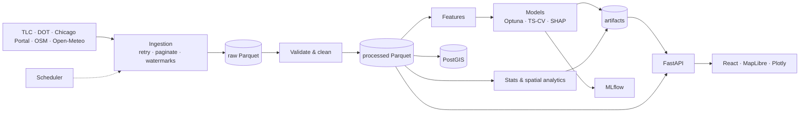

# Urban Mobility & Traffic Intelligence System

A geospatial data-science platform that ingests real urban transport data, models it, and
serves it through a FastAPI backend and a React map dashboard. It covers NYC taxi trips,
NYC DOT live road speeds, the Chicago Traffic Tracker, Chicago crashes, OpenStreetMap and
Open-Meteo. From these it forecasts congestion, segment speeds, journey times and zone
demand, and it locates statistically significant crash hotspots.

> **Integrity rules built into the code:** every chart and number comes from ingested
> data or from models evaluated on held-out time periods. When data is missing, the API
> returns `not_ready` and the UI shows the command that produces it. Nothing is filled with
> placeholders. Archived sources are labelled *historical*, and live data older than the
> freshness threshold is labelled *latest available*.

---

## 1. Business problem

Transport authorities, city planners and logistics teams need answers to questions like these:

| # | Question | Where it is answered |
|---|---|---|
| 1 | Where and when does congestion occur? | Live Traffic → Chicago patterns (hour × weekday ratio heatmap, Moran's I) |
| 2 | Predicted congestion for a road or zone? | Traffic Prediction (4-class classifier, speed regressor; 15 min – 24 h) |
| 3 | How long will a journey take at a given time? | Traffic Prediction → Travel time (NYC TLC zones) |
| 4 | Which areas have the highest crash risk? | Accident Intelligence (Gi* hotspots with FDR control, DBSCAN/HDBSCAN/K-Means/KDE) |
| 5 | How does weather affect traffic? | Weather Impact (de-seasonalised correlations, ANOVA, χ², model error by weather) |
| 6 | Peak mobility hours across areas? | Mobility Analytics, Overview (borough peak hours, CI profiles) |
| 7 | Recurring bottlenecks? | Live Traffic → recurring bottlenecks (peak-hour congestion share and day recurrence) |
| 8 | Weekday, weekend, holiday and seasonal effects? | Welch / Mann-Whitney tests, STL decomposition, calendar features |
| 9 | Demand forecasts for the next 1 h, 6 h and 24 h? | Direct multi-horizon LightGBM/XGBoost + SARIMA + Prophet (+ optional LSTM) |
| 10 | Where is infrastructure investment most needed? | Geospatial Explorer → infrastructure priority index (serious crashes + recurring congestion per H3 cell) |

## 2. Architecture



The full system, pipeline and ML-workflow diagrams are in [docs/architecture.md](docs/architecture.md).

| Layer | Stack |
|---|---|
| Data engineering | Pandas, Polars, PyArrow, DuckDB, GeoPandas, SQLAlchemy, PostgreSQL/PostGIS, APScheduler |
| Geospatial | OSMnx, Shapely, H3, libpysal/esda, scikit-learn KDE, Folium/PyDeck (notebooks), MapLibre GL (UI) |
| ML / statistics | scikit-learn, XGBoost, LightGBM, CatBoost, statsmodels (SARIMA, STL, tests), Prophet, Optuna, SHAP, MLflow |
| Serving | FastAPI, Pydantic v2, uvicorn |
| Frontend | React 18, TypeScript, Tailwind CSS, Plotly.js, MapLibre GL JS |
| Infra | Docker, docker-compose (PostGIS, MLflow, API, scheduler, UI) |

## 3. Data sources (verified 2026-11-24)

| Source | ID / path | Status | Role |
|---|---|---|---|
| NYC TLC Yellow / Green / HVFHV + zones | CloudFront Parquet | through 2026-09 | Demand, OD flows, travel time |
| NYC DOT Traffic Speeds | `i4gi-tjb9` | **live** | Live speeds, anomalies |
| Chicago Traffic Tracker (historical) | `4g9f-3jbs` | **archived ≈ May 2026** | Speed & congestion models |
| Chicago Traffic Tracker (current) | `n4j6-wkkf` | **deprecated** | superseded by `4g9f-3jbs` |
| Chicago Traffic Crashes | `85ca-t3if` | daily | Hotspots, severity, safety features |
| OpenStreetMap | OSMnx / Overpass | — | Road class, intersections, connectivity |
| Open-Meteo | archive + forecast | — | Weather features |

The original brief named `n4j6-wkkf` for Chicago traffic. Verification showed that dataset is
deprecated and that its successor has also stopped updating. Chicago traffic is therefore
modelled as a **historical** source, and the live component comes from NYC DOT. Schemas,
cadences, time-zone handling and fallbacks are documented in
[docs/data_sources.md](docs/data_sources.md).

Scope is kept explicit throughout. Taxi trip counts measure **taxi/for-hire demand, not total
road traffic**. NYC demand, Chicago road speeds and Chicago crashes are analysed separately.

## 4. Data engineering workflow

* **Verification** (`python -m src.pipeline verify`) checks every endpoint, compares the live
  schema with the configured columns, and records publisher freshness and deprecation flags.
* **Incremental ingestion** uses per-source watermarks, `$where` date windows, `$select`
  column projection and stable `$order` + `$offset` pagination. Chicago traffic is pulled week
  by week, anchored on the archive's last timestamp. TLC months are skipped when they already
  exist, and published months are probed with HEAD requests.
* **Reliability** comes from exponential-backoff retries that honour `Retry-After`, atomic
  temp-file writes, a run ledger (`data/raw/_runs.jsonl`) and per-source failure isolation.
* **Validation** covers required columns, type coercion, range checks, bounding-box
  coordinate checks, key duplicates, IQR outliers and missingness. Results are saved as JSON
  reports and shown on the monitoring page.
* **Zones:** `data/raw` (immutable partitions), `data/processed` (clean tables),
  `data/external` (zones, OSM), `artifacts/` (models and analytics), plus an optional
  **PostGIS** historical store loaded with upserts (`python -m src.pipeline load-db`).
* **Scale controls:** DuckDB processes multi-million-row TLC Parquet directly on disk, columns
  are pruned after download, the training sample is drawn with a reservoir sampler, and
  tuning runs on the most recent rows.

## 5. Exploratory & statistical analysis

`src/analytics/eda.py` computes everything shown in the analytics pages:

* hourly profiles with t-based 95% CIs (weekday vs weekend), weekday × hour heatmaps, and STL
  decomposition (daily and weekly) with seasonal and trend strength
* Welch t-test, Mann-Whitney U and Cohen's d for weekday/weekend and holiday contrasts
* Pearson (Fisher-z CI) and Spearman correlations of weather against de-seasonalised speed,
  demand and crash anomalies
* one-way ANOVA (η²) and Kruskal-Wallis on peak-hour speed by rain intensity
* χ² with Cramér's V for severity against lighting and reported weather
* Global Moran's I, Local Moran's I (LISA) and Getis-Ord Gi\* on H3 res-8 cells
  (999 permutations, Benjamini-Hochberg FDR)
* recurring bottlenecks: share of weekday peak intervals at High/Severe congestion, and the
  share of days on which that recurs

## 6. Feature engineering (leakage-safe)

| Group | Features |
|---|---|
| Temporal | hour, weekday, week, month, weekend, US federal + state holidays, peak flag, sin/cos encodings |
| Historical traffic | speed at issue time; −15 min, −30 min, −1 h, −24 h and −7 d lags; 1 h / 3 h rolling mean, sd and observation count; congestion ratio; rolling congestion index; H3-neighbour speed; segment × weekday × hour profile |
| Geospatial | segment length, OSM road class/rank, lanes, maxspeed, intersection density, mean node degree, distance to major road, H3 cell |
| Weather | temperature, precipitation, wind, humidity, snowfall (taken at **issue** time) |
| Safety | crashes per year within 150 m and serious-injury share (crashes **before the training cutoff** only) |
| Demand | lags from horizon H, 24 h / 48 h / 168 h lags, rolling stats, adjacent-zone demand |

For horizon H, every lag is shifted by at least H. Free-flow speeds, profiles and history
tables are fitted on the training period only. `tests/test_features.py` changes data after
the issue time and checks that the features stay identical.

## 7. Machine learning methodology

| Model | Target | Algorithms | Baselines |
|---|---|---|---|
| 1 Congestion classification | Low / Moderate / High / Severe (speed ÷ free-flow: <0.4, <0.6, <0.8, ≥0.8) | RF, XGBoost, LightGBM, CatBoost | persistence class, historical-profile class |
| 2 Segment speed | mph at +15 min / 1 h / 6 h / 24 h | XGBoost, LightGBM, RF, HistGB + quantile LightGBM (80% PI) | persistence, historical profile |
| 3 Travel time | taxi trip minutes | LightGBM, XGBoost, HistGB, RF | distance ÷ city hourly speed, OD historical median |
| 4 Demand | pickups per zone-hour at +1 h / 6 h / 24 h | LightGBM, XGBoost (direct, log target, quantile PI), SARIMA, Prophet, optional LSTM | seasonal naive (−168 h), same hour yesterday |
| 5 Crash hotspots | — | DBSCAN (haversine), HDBSCAN, K-Means, KDE, Gi\* / LISA | — |
| 6 Anomalies | — | Isolation Forest, LOF, robust z vs hour × weekday profile | — |

**Validation protocol:** chronological 70/15/15 split → Optuna per algorithm (scored on
validation) → `TimeSeriesSplit` CV for stability → model selection on the **validation**
score → refit on train+valid → a single evaluation on **test**. Baselines are scored on the
same test rows. Empirical coverage of the prediction intervals is reported. SHAP
(TreeExplainer), native importance and error breakdowns by hour, segment and weather are
saved for every model. Each run is logged to MLflow, and models are versioned under
`artifacts/models/<task>/<version>/`.

## 8. Model evaluation results

Results are produced by training on the ingested data. They are **not** committed by hand.
After a pipeline run, `python scripts/make_report.py` regenerates
[docs/model_evaluation_report.md](docs/model_evaluation_report.md) from the registered
artifacts. The Model Performance page shows the same numbers live, including confusion
matrices, SHAP plots and comparisons against baselines.

## 9. Geospatial methodology

* Chicago tracker segments are buffered and matched to OSM edges in UTM 16N (EPSG:26916).
  Intersections are OSM nodes with three or more streets.
* Spatial statistics run on H3 resolution-8 cells with k=1 ring contiguity weights (row
  standardised for Moran, binary for Gi\*).
* DBSCAN and KDE use haversine distance on a ball tree, so ε and bandwidth are in metres.
* OD flows connect zone centroids computed in EPSG:2263.

## 10. Application

| Page | Highlights |
|---|---|
| Executive Overview | KPIs with CIs and freshness badges, demand trend, observed vs forecast congestion, crash trend |
| Live Traffic | NYC DOT links coloured by speed relative to the same hour; link history; anomalies; Chicago archive with bottlenecks |
| Traffic Prediction | segment / horizon / zone selectors, actual vs predicted with 80% intervals, forecast map, travel-time estimator |
| Mobility Analytics | hourly CI profiles, heatmap, zone choropleth (demand / net inflow), OD arcs with hour filter, demand clusters, STL |
| Accident Intelligence | Gi\* / DBSCAN / HDBSCAN / K-Means / KDE layers; severity, weather, hour and date filters; causes; temporal trends |
| Weather Impact | correlation table with CIs, ANOVA, scatter, crash–weather χ², model error by observed weather |
| Geospatial Explorer | toggles for OSM network, segments, H3 Gi\* layers and infrastructure priority; feature inspector |
| Model Performance | registry with baseline lift, candidate table, confusion matrix, SHAP beeswarm, error analysis |
| Data & Pipeline | per-source status, freshness, records, failures, API verification, quality reports, run log |

**Screenshots:** take them after the first real pipeline run (`docs/screenshots/`). The UI
renders only computed data, so screenshots made before ingestion would just show empty states.

## 11. Installation

### Option A — Docker (recommended)

```bash
git clone https://github.com/comp3ngrBasit/urban-mobility-intelligence && cd urban-mobility-intelligence
cp .env.example .env                       # optionally add SOCRATA_APP_TOKEN
docker compose up -d db mlflow             # PostGIS + MLflow
docker compose run --rm pipeline verify    # check every source
docker compose run --rm pipeline all       # ingest → clean → train → analyze → load PostGIS
docker compose up -d api scheduler ui      # API :8000, UI :8080, MLflow :5000
```

### Option B — local Python + Node

```bash
python -m venv .venv && source .venv/bin/activate
pip install -r requirements.txt
cp .env.example .env
python -m src.pipeline verify
python -m src.pipeline all                 # or stage by stage: ingest | clean | train | analyze
uvicorn backend.main:app --port 8000
cd frontend && npm install && npm run dev  # http://localhost:5173 (proxies /api)
python scripts/scheduler.py                # automated refresh (separate terminal)
```

**Default window sizes** (configurable in `configs/sources.yaml`): 3 TLC months (yellow +
green), 60 days of Chicago traffic, 2 years of crashes and 72 h of NYC DOT. A first full run
downloads roughly 1–2 GB. Training on a laptop takes tens of minutes; reduce
`optuna_trials` in `configs/models.yaml` to speed it up.

## 12. API

OpenAPI documentation is served at `/docs`. Example requests are in
[docs/api_examples.md](docs/api_examples.md). Main routes:

`/api/overview` · `/api/live/{nyc,chicago,anomalies}` · `/api/predict/{options,segments,segment/{id},zones,zone/{id},travel-time}` ·
`/api/mobility[/od|/decomposition]` · `/api/traffic` · `/api/accidents/{summary,hotspots,points}` ·
`/api/weather/{impact,predictions-by-condition}` · `/api/geo/{taxi-zones,chicago-segments,road-network,h3,infrastructure,infrastructure-priority}` ·
`/api/models[/{task}[/predictions]]` · `/api/pipeline/{status,runs,quality}` · `/api/health`

Secrets such as the Socrata token are read server-side from `.env` only. The frontend has no keys.

## 13. Testing

```bash
pytest -q                     # unit, feature-leakage, model-pipeline, API endpoint tests
cd frontend && npm test       # component tests (Vitest + Testing Library)
```

The Python tests run offline against **synthetic fixtures** (`tests/fixtures.py`) that copy
the source schemas. They check that code paths work: training, registration, serving, empty
states, NaN-safe JSON and leakage. They do not measure model quality, and fixture outputs
never reach `data/`, `artifacts/` or this README.

## 14. Reproducibility

* Fixed seeds (42) for splits, Optuna's TPE sampler, models and permutation tests.
* All windows, thresholds and hyperparameter budgets live in `configs/*.yaml`.
* Each model version stores its feature list, target, horizon, data period, split
  boundaries, library versions and test predictions.
* The notebooks (`notebooks/01–06`) are committed without outputs and call the same `src/`
  functions. Run `jupyter nbconvert --execute --inplace notebooks/*.ipynb` after the pipeline.

## 15. Limitations

* **No live Chicago traffic.** The City of Chicago has archived the tracker, so Chicago
  forecasts target the period right after the archive ends and cannot be checked against
  actuals. They show methodology, not current conditions.
* Taxi demand is not the same as total traffic. TLC data has a publication lag of about two
  months, so "next-hour" demand forecasts start from the latest published month.
* NYC DOT covers a few hundred sensor links, mostly on highways and major arterials.
* Weather comes from one point per city (city-centre reanalysis), so micro-climate effects
  are not captured. Correlations are associations, not causal effects.
* Tracker speeds come from CTA bus GPS and therefore reflect bus-route arterials.
* Crash locations are as reported by police, and very low-severity crashes may be
  under-reported.

## 16. Future improvements

* Graph neural networks (e.g. DCRNN or Graph WaveNet) over the OSM-matched segment graph
* Open-Meteo forecast weather at target time for operational forecasts
* Conformal prediction intervals with guaranteed coverage
* Map-matching TLC trips to OSM for link-level travel times
* Kafka/Redpanda streaming for DOT speeds; dbt models in PostGIS
* Additional cities through the source registry (e.g. Seattle, San Francisco)
