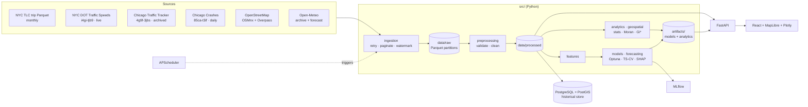
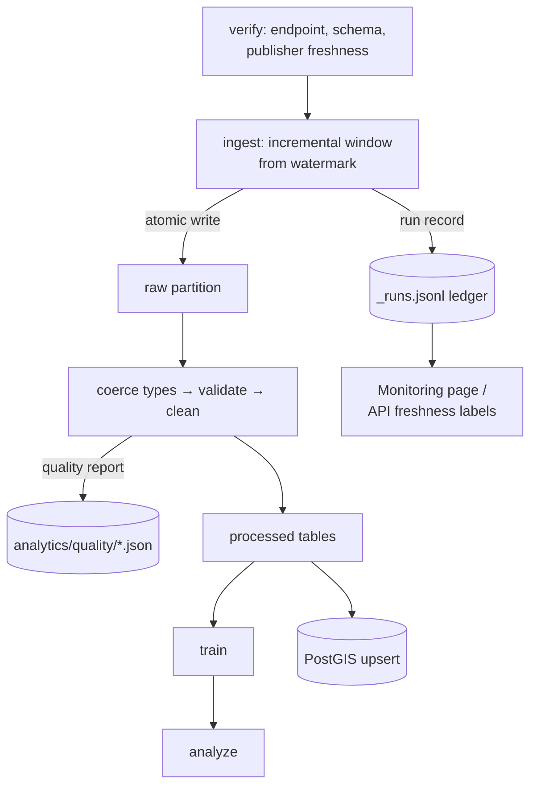
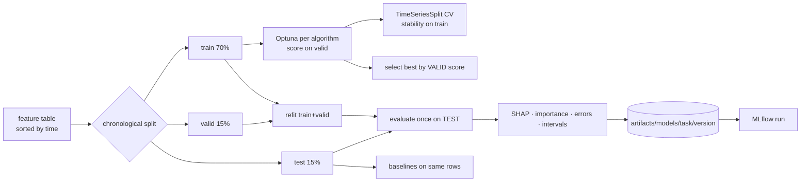

# Architecture

## System architecture

## Data pipeline

Failure isolation: every source runs in its own guarded stage. A failed pull is recorded in
the ledger and leaves the previous partitions untouched, so the API keeps serving the last
successful data with its real `data_as_of` timestamp and a "latest available" label.

## ML workflow

Leakage controls:
* every lag/rolling feature is shifted by the forecast horizon (tested in `tests/test_features.py`);
* free-flow speed, speed profiles, crash-exposure and OD/zone history are fit on the training period only;
* weather is joined at the forecast *issue* time, not the target time;
* model selection uses the validation period; the test period is scored once.
